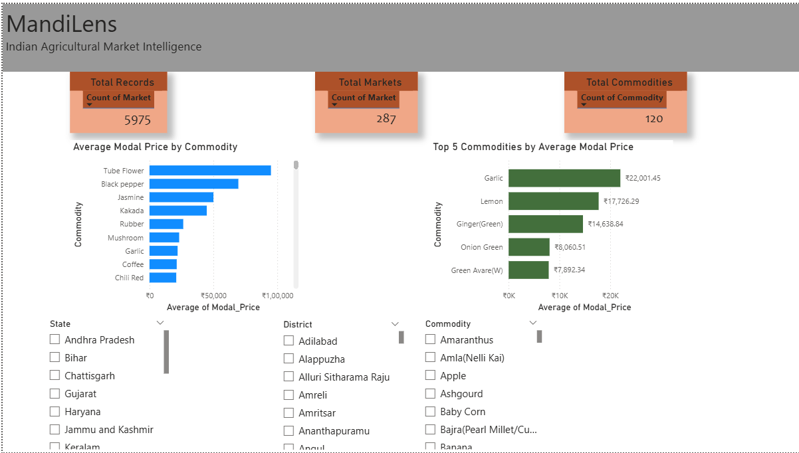

# 🌾 MandiLens — Indian Agricultural Market Intelligence

MandiLens is a data analytics project that explores agricultural commodity prices across Indian mandis (markets). It uses Python, Pandas, SQL, and Power BI to clean, analyze, and visualize mandi price data.

## 📌 Project Overview

The goal of MandiLens is to make agricultural market price data easier to understand through interactive dashboards and data analysis.

The project currently analyzes a daily snapshot of mandi prices and provides state, district, and commodity-level filtering.

## ✨ Features

- Data cleaning and preprocessing using Python and Pandas
- Data quality validation and duplicate checking
- SQL-based commodity and market analysis
- Interactive Power BI dashboard
- State, district, and commodity slicers
- Commodity-wise average modal price comparison
- Top 5 commodities by average modal price
- CSV exports for further analysis

## 🛠️ Technologies Used

- Python
- Pandas
- Matplotlib
- SQL
- SQLite
- Power BI
- CSV

## 📊 Dashboard


The Power BI dashboard includes:

- Total Records
- Total Markets
- Total Commodities
- Average Modal Price by Commodity
- Top 5 Commodities by Average Modal Price
- Interactive State, District, and Commodity filters

## 📂 Project Structure

```text
MANDILENS/
├── data/
│   ├── data123.csv
│   ├── cleaned_mandi_prices.csv
│   ├── madhya_pradesh_prices.csv
│   ├── mp_commodity_summary.csv
│   └── mandilens.db
├── notebooks/
│   ├── 01_data_inspection.py
│   ├── 02_mp_price_analysis.py
│   ├── 03_soyabean_analysis.py
│   ├── 04_data_cleaning.py
│   └── 05_sql_analysis.py
├── dashboard/
├── README.md
└── MandiLens.pbix
```

## 📥 Dataset Source

The dataset was obtained from the Government of India's Open Government Data platform, data.gov.in.

Dataset: *Current Daily Price of Various Commodities from Various Markets (Mandi)*

The available snapshot contains mandi price records, including state, district, market, commodity, variety, arrival date, minimum price, maximum price, and modal price.

## 🔍 Data Quality

The cleaning process includes:

- Checking missing values
- Checking duplicate records
- Converting price columns to numeric values
- Converting arrival dates to datetime format
- Validating minimum, maximum, and modal prices
- Calculating the price range

## ⚠️ Limitations

- The current dataset represents a single-day snapshot, not a historical time series.
- Madhya Pradesh has only 29 records in this snapshot.
- Harda has only one available record in the current snapshot.
- Results may not represent all mandis or actual market conditions across India.
- Price comparisons should account for commodity varieties and units.
- The project does not currently provide validated future price forecasts.

## 🚀 Future Improvements

- Integrate regularly updated mandi data
- Add historical price trend analysis
- Develop a more detailed regional market comparison
- Explore forecasting after sufficient historical data becomes available
- Improve dashboard usability and reporting

## 👨‍💻 Author

**Rohan Dugaya**

B.Tech — Computer Science Engineering (AI & Data Science)

---

*Built as a data analytics portfolio project to explore Indian agricultural market data.*
